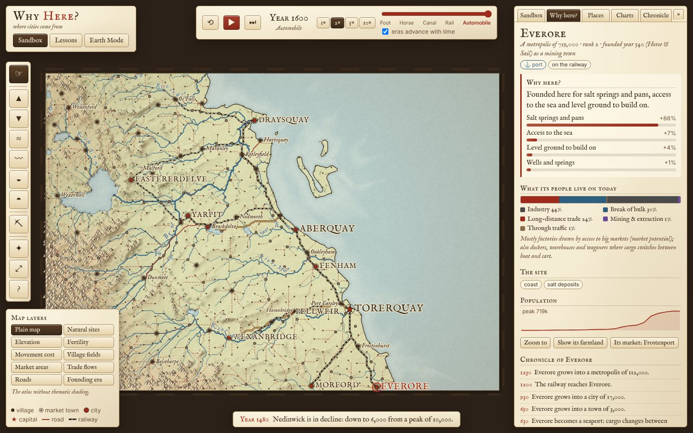
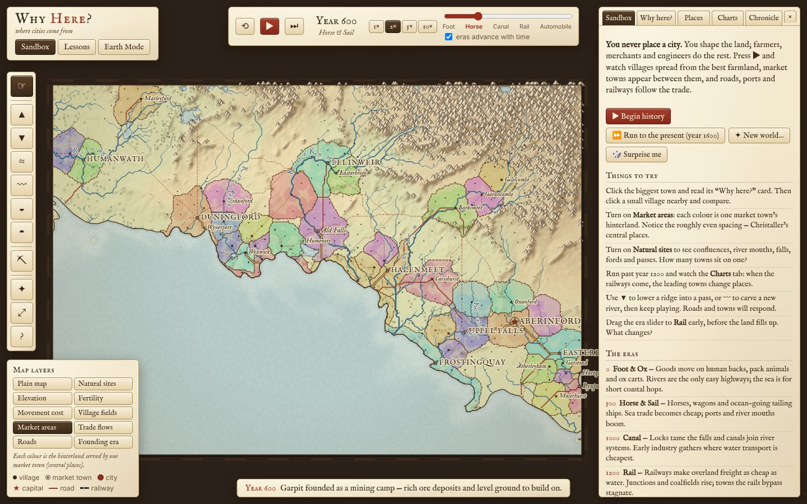
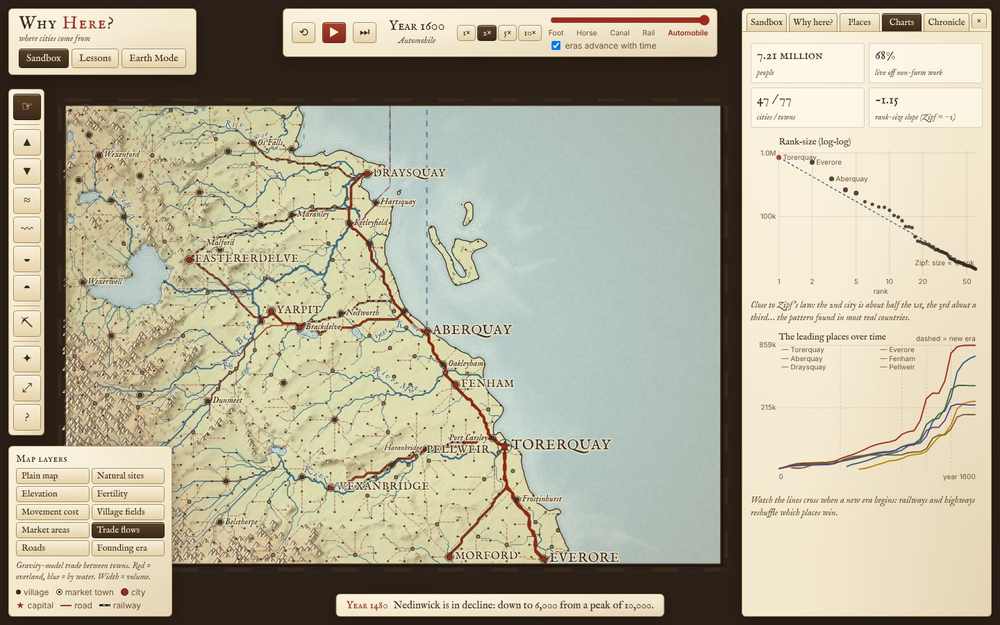
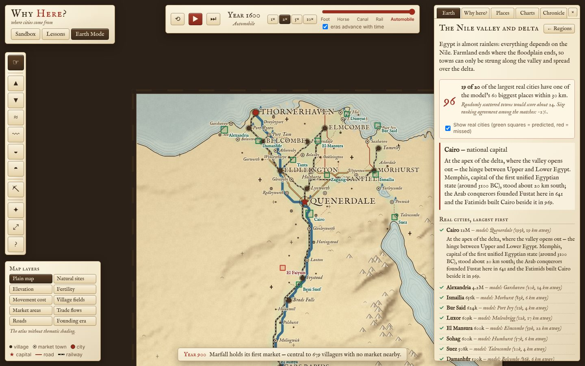
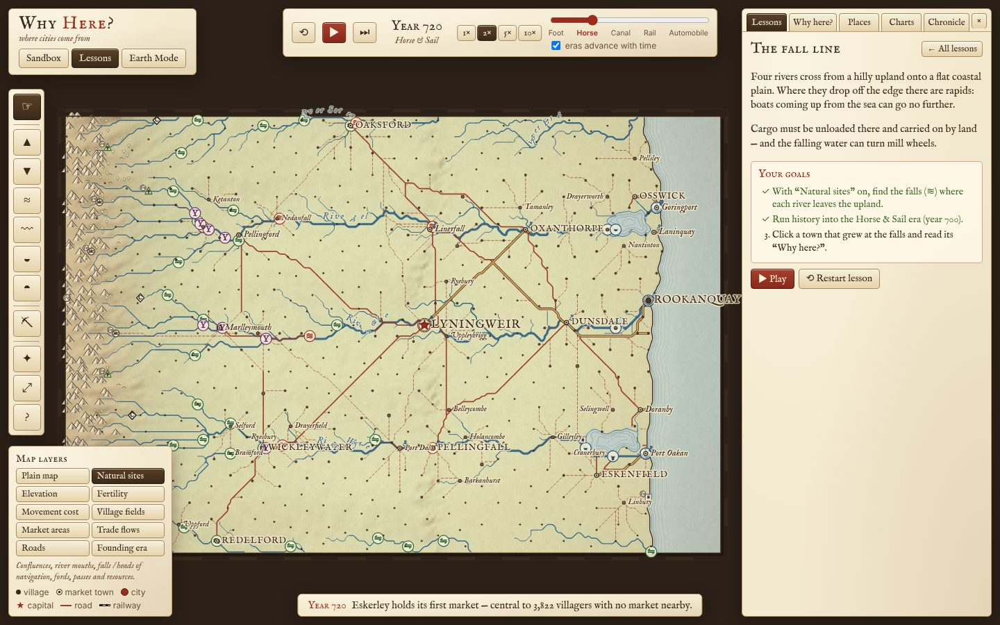

# Why Here?

**Where cities come from — a settlement-emergence sandbox in the browser.**

You never place a city. You shape the land and pick an era; farming villages, market towns, roads, ports, railways and capitals emerge on their own from the rules of economic geography. Click any settlement to ask **“Why here?”** and read the reasons it won: fertile land within a day’s walk, a ford, the meeting of two rivers, a sheltered harbour, the falls where boats must unload.

Then switch to **Earth Mode**, run the very same model on the real Nile, Rhine, Mississippi, Japan, the Yangtze and more, and see where it agrees with reality — and the history lesson behind every place it gets wrong.



**Live:** after the deploy workflow runs on `main`, the site is served from GitHub Pages at `https://<user>.github.io/why-here/` (enable *Settings → Pages → Source: GitHub Actions* once).

## Three ways to play

| | |
|---|---|
| **Sandbox** | Generate a world from a seed (coast, continent, peninsula, archipelago or inland; latitude sets the climate). Press ▶ and watch 1,600 years of history. Sculpt with brushes (raise, lower, smooth, carve a river, flood, drain, place resources) and see rivers re-route and towns respond. Drag the era slider to jump ahead or back. |
| **Lessons** | Six guided maps, each teaching one idea with small goals that tick off as you play, ending with the real-world story: *A day’s walk* (the ten-mile rule), *The fall line*, *Where rivers meet*, *Break of bulk*, *The mountain pass*, *The railway age*. |
| **Earth Mode** | Ten curated regions on real elevation, coastlines and rivers. After the run, the real cities are revealed and scored, and each one comes with a researched note. |



## The model

Everything is deterministic for a given seed and lives in `src/sim/` (no DOM). It runs in a Web Worker; the UI only renders snapshots.

### Land
* **Terrain** (`terrain.ts`): domain-warped fBm simplex noise shaped by a style mask (coast, continent…), ridged noise in an orogenic belt for mountain ranges, a concave height profile for broad coastal plains, then **droplet hydraulic erosion** (after Beyer / Lague) and a thermal talus pass.
* **Climate** (`climate.ts`): temperature from latitude and altitude; precipitation from a zonal profile (wet tropics, dry subtropics, wet mid-latitudes) advected along the prevailing wind (westerlies or trade winds by latitude), with **orographic rain on windward slopes and a rain shadow behind mountains** measured on smoothed relief.
* **Hydrology** (`hydrology.ts`): sea = below sea level and connected to the edge; **priority-flood depression filling with an epsilon gradient** (Barnes et al. 2014) so water always drains; large filled depressions become lakes; D8 steepest-descent flow directions; precipitation-minus-evapotranspiration runoff accumulated downstream gives discharge in m³/s. From that: visible rivers, **navigable reaches** (big and gentle, gradient averaged over ~10 km), **confluences**, **river mouths**, **falls / heads of navigation** (first steep reach above navigable water), **fords** (shallow, slow, mid-sized rivers on flat floors) and **mountain passes** (saddle points).
* **Land value** (`layers.ts`): fertility from temperature, water balance, slope and altitude, with **alluvial floodplains** and **irrigation in dry climates** (the Nile effect), a penalty for leached hot-wet lowlands and marshes; forest; **defensibility** (local prominence, water on several sides); **harbour quality** (shelter measured by rays from the shore, depth, estuary bonus); resource deposits placed where geology makes sense.

### Movement
`movement.ts` builds a **two-layer graph**: a land node and (where there is navigable water, sea, lake or canal) a water node per cell. Land edges cost distance × terrain (slope, forest, marsh, roads); entering a river overland costs a crossing (cheap at fords and bridges). Water edges are cheap downstream, dearer upstream, cheapest at sea. **Switching layers costs a fixed transfer** — loading and unloading cargo — which is exactly what makes break-of-bulk points valuable. Each era has its own cost table (foot & ox → horse & sail → canal locks → rail → automobile). Least-cost paths use Dijkstra over precomputed edge tables.

### Emergence (`emergence.ts`, 10-year steps)
* **Villages**: the first farmers take the best sites (fertile land within ~8 km — a ten-mile round trip — plus water, safety, level ground, special sites). Full villages send settlers to the best free land nearby; occasionally pioneers leap to a distant empty site. Each village farms the land within a day’s walk (bounded least-cost search), so spacing emerges rather than being imposed.
* **Market towns**: when villagers are more than half a day from a market, the most central village (weighted by the unserved population around it, crossroads traffic and site quality) starts holding one. This reproduces **Christaller’s** evenly spaced central places; markets with the widest hinterlands become regional centres.
* **Trade**: a **gravity model** (size × size ÷ cost²) between the biggest places — one per urban region — plus trade with the world beyond the map edge (sea edges and big rivers leaving or entering the map). Flows are routed along least-cost paths over land, river and sea.
* **Roads and path dependence**: traffic on each edge is remembered; busy edges become tracks, roads and highways, which make those routes cheaper, which attracts more traffic.
* **Special towns**: cargo transfers with no town nearby found a **port** or **river port**; heavy traffic crossing a big river founds a **crossing town**; traffic over a pass founds a **pass town**; valuable deposits within reach of a market found **mining towns** (gold rushes included); **canals** are dug across short portages on busy water routes; **railways** link the biggest places along gentle gradients, and **junctions** spawn towns.
* **Growth**: farm population grows toward its land’s capacity in each era. The non-farm population (a share that rises from ~8% to ~68% across eras) is divided among towns by an era-weighted mix of drivers — market services, long-distance trade, break of bulk, through traffic, industry (market potential × size, Gibrat-style), extraction and government — with a mild agglomeration exponent. Weights shift by era, so **the railway age visibly reshuffles the winners**. A **capital** is chosen among big, central places and then attracts government.
* **Why here?** Every settlement stores the weighted factors that made its site win at founding (shown as percentages), why it became a market, its site facts, what its people live on now, its population history and its own chronicle.
* **Zipf**: the Charts tab fits log(size) against log(rank). Early farming societies come out flatter than Zipf (many similar towns); industrial eras approach a slope of about −1.



## Earth Mode



**Data.** `scripts/build-regions.ts` runs at build time (not in CI) and commits compact files to `public/regions/` (~1 MB for all ten regions):

* Elevation: **AWS Terrain Tiles** (Mapzen Terrarium encoding), averaged onto an equal-area-ish grid of 1.5–5.8 km cells.
* Coastline, lakes, river centre-lines and populated places: **Natural Earth 1:10m** (public domain).
* Rivers from Natural Earth are “burned” into the DEM so the simulated rivers follow the real ones; rivers entering from off-map get their mean discharge (e.g. the Nile’s natural ~2,800 m³/s, the Missouri, the upper Mississippi, the Jinsha); only rivers that really leave the frame can drain over its edge.
* Each region gets a measured precipitation baseline (and, for the eastern US and Japan, no single rain-bearing wind), because a zonal climate model cannot know about monsoons or Gulf moisture. A handful of famous resource deposits are placed by hand (Ruhr and Saar coal, Pittsburgh coal, Birmingham iron, Potosí silver…).

The **simulation itself is unchanged**: no per-region tuning of the emergence rules.

**Scoring.** The 20 largest real cities (suburbs within the match radius merged into their city) are matched one-to-one with the model’s 60 biggest places within ~30 km (6 cells on coarse grids). The score weights big cities more (1/√rank). It is shown next to a **baseline: the score of the same number of towns scattered at random on land** — the honest yardstick. A rank correlation reports whether the sizes agree.

| Region | Score | Random baseline | Comment |
|---|---|---|---|
| Nile valley & delta | **96** | 24 | 19 of 20 cities found; the model’s capital lands 19 km from Cairo, at the delta apex. Misses the Faiyum, fed by a canal it doesn’t know. |
| Low Countries | **92** | 70 | High, but so is the baseline: a small, densely urban region. |
| Central Japan | **81** | 45 | People crowd onto the few plains; the model’s capital lands 20 km from Kyoto. |
| Rhine | **42** | 35 | River ports, confluences and the Ruhr, but capitals and courts (Bonn, The Hague, Brussels, Stuttgart, Karlsruhe) are invisible to it. |
| US East Coast fall line | **37** | 22 | Fall-line and bay towns; misses New York (Erie Canal, off the map) and planned capitals. |
| Yangtze | **36** | 14 | Confluence cities such as Wuhan; misses treaty-port Shanghai’s scale and Grand Canal cities. |
| Mesopotamia | **36** | 15 | The irrigated river towns; misses oil cities, shrine cities and the rain-fed north. |
| Great Lakes | **28** | 12 | Weak — most lake trade went to the Atlantic, off the map — but its capital lands at Detroit’s strait. |
| Mississippi & Ohio | **20** | 13 | Weak: a railway-era map. Its capital lands near Cairo, Illinois, repeating a famous failed 19th-century prediction. |
| Central Andes | **11** | 11 | No skill: highland farming, desert oases and colonial capitals break a lowland model’s assumptions. |

(Numbers from the current model version; the app always shows the live score and baseline.) The interesting part is the **misses**: every region panel lists them with a short researched note — political capitals (Washington, Bonn, Edo/Tokyo, Lima), canals (Suez, Erie, the Faiyum), railways (Chicago, Atlanta), oil (Kuwait City, Kirkuk, Abadan), pilgrimage (Najaf, Karbala) and treaty ports (Shanghai, Yokohama).



## Tech

* **TypeScript + Vite**, no UI framework. Static site; GitHub Actions (`.github/workflows/deploy.yml`) runs the tests, builds and deploys to Pages on every push to `main`.
* **Canvas 2D** rendering. The map is mostly line-work and lettering — coastlines, water-lining, rivers, roads, hachured mountains, italic labels with halos — which Canvas 2D draws beautifully and fast enough: the hillshaded parchment is baked once into a raster, vector geometry is cached as `Path2D` in cell coordinates, and each frame just sets the camera transform. WebGL would add complexity for little gain at this map size.
* **Web Worker** for the simulation (`src/worker/`), so the UI stays smooth; snapshots are posted back after each step.
* Look: an antique engraved atlas — parchment, sepia ink, hand-tinted lowlands, water-lined coasts, red roads, IM Fell type (SIL Open Font License, via Fontsource).

```bash
npm install
npm run dev        # local dev server
npm test           # unit tests (hydrology, pathfinding, emergence, Earth scoring)
npm run build      # type-check + production build into dist/
npx tsx scripts/build-regions.ts [regionId…]   # rebuild Earth Mode data (needs network)
```

(Behind an HTTP proxy, run the region script with `NODE_USE_ENV_PROXY=1` so Node’s `fetch` uses it.)

## Decisions and simplifications

* Time runs in 10-year steps over 1,600 abstract years; eras start at years 0, 500, 1000, 1200 and 1400 (auto), or you set the era yourself.
* On large Earth regions each model “village” stands for a cluster of real villages (the farm radius grows so the count stays near 1,500), and trade is computed between at most 15 nodes, one per urban region, for speed.
* The ten-mile rule is a radius of about 8 km on foot; real villages are often closer, and the lesson says so.
* Brush edits rebuild the hydrology; with “Keep history” on, settlements, roads and railways persist (towns on new water are drowned).
* Canals are dug only across short portages between navigable waters on busy routes; no attempt to model locks in detail beyond letting boats pass falls in the canal era.
* Names are generated (with suffixes from the site: *-ford*, *-mouth*, *Falls*, *-haven*…) — including in Earth Mode, where the model’s towns are predictions, not the real places.

## Sources and further reading

* Walter Christaller, *Die zentralen Orte in Süddeutschland* (1933) — central place theory.
* Johann Heinrich von Thünen, *Der isolierte Staat* (1826); Michael Chisholm, *Rural Settlement and Land Use* (1962) — distance and farming.
* Charles H. Cooley, “The Theory of Transportation” (1894) — cities at breaks in transportation.
* Gravity models of trade (Tinbergen 1962; Zipf 1946); Chauncy Harris, “The market as a factor in the localization of industry” (1954) — market potential.
* Zipf’s law for cities (Auerbach 1913; Zipf 1949); Xavier Gabaix, “Zipf’s law for cities: an explanation” (1999) — Gibrat-style growth.
* William Cronon, *Nature’s Metropolis: Chicago and the Great West* (1991) — railways, Chicago and St. Louis.
* R. Barnes, C. Lehman, D. Mulla, “Priority-flood” (2014); O’Callaghan & Mark (1984) — D8 flow routing.
* Hans Theobald Beyer (2015) and Sebastian Lague — droplet erosion.
* Data: [Natural Earth](https://www.naturalearthdata.com/) (public domain); [AWS Terrain Tiles](https://registry.opendata.aws/terrain-tiles/) (Mapzen/Tilezen; sources include SRTM, GMTED2010, ETOPO1 and others — see the [attribution list](https://github.com/tilezen/joerd/blob/master/docs/attribution.md)).

See [PROGRESS.md](PROGRESS.md) for status and known issues.
